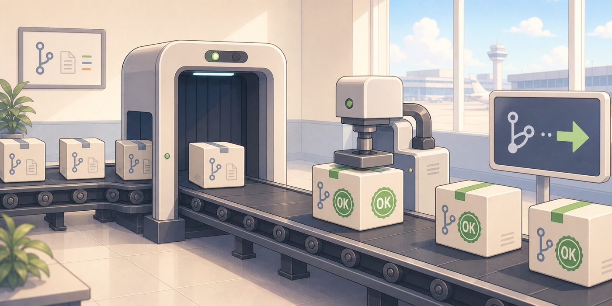

# pr-seal-action

<p align="center">
  
</p>

`pr-seal-action` verifies a pull request and, when it passes, approves that exact head. The default seal then enables auto-merge or merges the same head. Callers can instead approve only, and can treat an out-of-scope pull request as a skipped result instead of a failed job.

The default contract is unchanged: one expected author, exact allowed paths, approval, then auto-merge or a clean-status merge, pinned to the verified head. Docs-only and non-executable config approval is opt-in.

## What It Does

1. Fetches the target pull request.
2. Requires the pull request to be open.
3. Fetches every changed file with GitHub API pagination bound to one head SHA and one base SHA before approval.
4. Requires the PR author login to exactly match `expected-author`, unless the caller opts out or lists more than one author.
5. Requires every changed file path to match the path policy. With only `allowed-paths`, that is still an exact match.
6. When regular-file checks are on, requires git mode `100644` for every side of the diff the change touches.
7. Reads the pull request again and stops if the head SHA, base SHA, or open state changed.
8. Creates an approval review with `approve-token` against the verified head SHA.
9. Reads the pull request again. If it changed, dismisses that approval and fails.
10. When `auto-merge` is true, enables auto-merge with `merge-token` and `expectedHeadOid` set to the verified head SHA.
11. If GitHub rejects auto-merge because the PR is already in clean status, directly merges the PR with the same verified head SHA and merge method.

If verification or a privileged operation fails, the action fails closed. Set `on-ineligible` to `skip` to report a policy rejection through outputs instead of failing the job. Missing data, API failures, unrecognized git modes, approval or merge failures, and a moved head or base still fail the job.

## What It Does Not Do

- It does not create GitHub App tokens.
- It does not create pull requests.
- It does not generate changelogs.
- It does not define workflow triggers.
- It does not delete the source branch after merge.
- It does not replace branch protection, required reviews, required checks, or repository auto-merge settings.
- It does not approve renamed files. The pull request file list used here does not include the previous path, so a rename cannot be checked safely.
- It does not judge copied files by their source path. A copy is judged by its destination path and, when regular-file checks are on, by the destination mode.

Use repository automatic head branch deletion or a separate cleanup workflow if branch cleanup is required.

## Inputs

| Name | Required | Default | Description |
| --- | --- | --- | --- |
| `repository` | No | Current repository | Repository in `owner/name` format. |
| `pull-request-number` | Yes |  | Pull request number to verify and, when eligible, approve. |
| `expected-author` | Conditional |  | Exact GitHub login expected for the PR author. Required unless `require-expected-author` is `false` or `expected-authors` is set. |
| `expected-authors` | No |  | Newline-separated logins accepted in addition to `expected-author`. |
| `require-expected-author` | No | `true` | When `false`, and neither author input is set, any author is acceptable. An author input that is set is still enforced. |
| `allowed-paths` | Conditional |  | Newline-separated exact file paths. Required unless `allowed-patterns` or `path-preset` is set. |
| `allowed-patterns` | No |  | Newline-separated globs. `*` and `?` do not match `/`. `**` matches across directories. |
| `denied-patterns` | No |  | Newline-separated globs. A match always rejects the path. |
| `path-preset` | No | `none` | `docs-and-config` allows documentation and non-executable configuration. Its denials always win over caller allow paths and patterns, and it forces regular-file checks on. |
| `require-regular-files` | No | `false` | Reject executable bits, symlinks, submodules, and directories. Forced on by `docs-and-config`. |
| `approve-token` | Yes |  | Token used to create and, if the head moves, dismiss the approval review. |
| `merge-token` | Yes |  | Token used to read the PR and git metadata, enable auto-merge, or merge. |
| `merge-method` | No | `squash` | Merge method when auto-merge is enabled. One of `squash`, `merge`, or `rebase`. |
| `approve-body` | No | Automated verification message | Body for the approval review. |
| `auto-merge` | No | `true` | When `false`, approve only. |
| `on-ineligible` | No | `fail` | `skip` sets `eligible=false` and a `reason` instead of failing the job. |

`docs-and-config` allows markdown and other documentation, license and notice files, images, and a fixed set of non-executable config files such as `.gitignore`, `.editorconfig`, `cliff.toml`, and `tsconfig.json`. It rejects workflows and composite actions, `action.yml`, scripts and other source files, lockfiles, package manifests, Dockerfiles, and other CI or build files. A file that is not on the allowlist and not on the denylist stays ineligible unless the caller also lists it in `allowed-paths` or `allowed-patterns`.

A glob such as `**/*.md` also matches markdown under `.github/workflows`. Use `path-preset: docs-and-config`, or a denied pattern such as `.github/workflows/**`, when that directory must stay excluded.

## Outputs

| Name | Description |
| --- | --- |
| `pull-request-id` | GraphQL node ID of the pull request that was read. |
| `head-sha` | Head SHA observed during verification. |
| `changed-files` | JSON array of changed file paths considered during verification. |
| `approved` | `true` when an approval review was created. |
| `auto-merge-enabled` | `true` when auto-merge was enabled. |
| `merged` | `true` when the PR was merged directly because GitHub reported it was already clean. |
| `eligible` | `true` when verification passed. `false` when `on-ineligible` is `skip` and the pull request is out of scope. |
| `reason` | Empty when the pull request is eligible. Otherwise a single-line explanation. |

Hard failures leave these outputs unset and fail the job.

## Example

```yaml
- name: Verify, approve, and enable auto-merge
  uses: y-writings/pr-seal-action@v1
  with:
    repository: ${{ github.repository }}
    pull-request-number: ${{ steps.changelog-pull-request.outputs.pull-request-number }}
    expected-author: app/y-writings-pr-creator-bot
    allowed-paths: |
      CHANGELOG.md
    approve-token: ${{ steps.approver-token.outputs.token }}
    merge-token: ${{ steps.pr-creator-token.outputs.token }}
    merge-method: squash
    approve-body: Automated approval for CHANGELOG.md-only release PR.
```

## Docs and config approval

Use this from a workflow that already runs on the default branch, such as `pull_request_target` or `workflow_dispatch`. Do not switch that workflow to `pull_request`: the pull request head would supply the workflow, and could change the policy before the app token approves it. Pin this action to a commit SHA.

The comment gate stays in place for every other pull request. Code changes still wait for the owner comment. A docs-only or config-only pull request is approved and the job stays green; an out-of-scope pull request sets `eligible` to `false` and does not fail the job.

```yaml
name: "[00] Approve pull request from comment"
on:
  issue_comment:
    types: [created]
  pull_request_target:
    types: [opened, synchronize, reopened, ready_for_review]
permissions:
  contents: read

jobs:
  approve:
    name: Approve pull request
    if: >-
      github.event_name == 'issue_comment' &&
      github.event.issue.pull_request &&
      github.event.issue.state == 'open' &&
      github.event.comment.user.login == 'y-writings' &&
      github.event.comment.body == 'approve'
    runs-on: ubuntu-latest
    steps:
      - name: Create approver GitHub App token
        id: approver-token
        uses: actions/create-github-app-token@bcd2ba49218906704ab6c1aa796996da409d3eb1 # v3.2.0
        with:
          app-id: ${{ vars.PR_APPROVER_APP_ID }}
          private-key: ${{ secrets.PR_APPROVER_APP_PRIVATE_KEY }}
          permission-pull-requests: write
      - name: Approve pull request
        uses: hmarr/auto-approve-action@f0939ea97e9205ef24d872e76833fa908a770363 # v4.0.0
        with:
          pull-request-number: ${{ github.event.issue.number }}
          github-token: ${{ steps.approver-token.outputs.token }}

  approve-docs-and-config:
    name: Approve documentation or config pull request
    if: github.event_name == 'pull_request_target'
    runs-on: ubuntu-latest
    permissions:
      contents: read
      pull-requests: read
    steps:
      - name: Create approver GitHub App token
        id: approver-token
        uses: actions/create-github-app-token@bcd2ba49218906704ab6c1aa796996da409d3eb1 # v3.2.0
        with:
          app-id: ${{ vars.PR_APPROVER_APP_ID }}
          private-key: ${{ secrets.PR_APPROVER_APP_PRIVATE_KEY }}
          permission-contents: read
          permission-pull-requests: write
      - name: Approve documentation or non-executable config
        id: seal
        uses: y-writings/pr-seal-action@v1
        with:
          pull-request-number: ${{ github.event.pull_request.number }}
          require-expected-author: false
          path-preset: docs-and-config
          auto-merge: false
          on-ineligible: skip
          approve-token: ${{ steps.approver-token.outputs.token }}
          merge-token: ${{ steps.approver-token.outputs.token }}
          approve-body: |
            Automated approval because every changed file is documentation or non-executable configuration.
```

`merge-token` is still required because it reads the pull request and, for this preset, the git trees. No merge is requested when `auto-merge` is false. The same approver token can be passed to both inputs when that token can read contents and write reviews.

## Token Guidance

Use separate tokens for approval and auto-merge when branch protection requires review by a different actor.

- `approve-token` should belong to the approver actor and have permission to create and dismiss pull request reviews.
- `merge-token` should belong to the PR creator or merge actor and have permission to read the PR, read git trees when regular-file checks are on, and enable auto-merge when `auto-merge` is true.

The approver actor must differ from the pull request author. When that condition is satisfied, `approve-token` and `merge-token` may be the same token. Use separate tokens if you want to keep the approver token at the minimum permissions needed only for approval.

Do not use broad organization-wide credentials when a repository-scoped GitHub App token is sufficient.

## Security Notes

With the default inputs, this action fails when the PR author differs from `expected-author`, when any changed file is outside `allowed-paths`, when a changed file was renamed, when the PR is not open, when the PR node ID or head or base SHA cannot be resolved, when approval fails, or when GitHub rejects both auto-merge enablement and the clean-status direct merge path.

Denied patterns, and the built-in denials of `docs-and-config`, win over `allowed-paths` and `allowed-patterns`. The preset's regular-file check cannot be turned off. Executable files, symlinks, submodules, and directories are out of scope when that check is on. An unrecognized git mode fails the job instead of being treated as ineligible.

Auto-merge and direct merge are both requested with GitHub GraphQL `expectedHeadOid`. Approval is requested with `commitOID`. Before and after approval, the action reads the head SHA and base SHA again. If either changed, or the pull request is no longer open, it does not merge. An approval created against the old head is dismissed.

`on-ineligible: skip` is only for policy results such as the wrong author, a disallowed path, or an executable file. It is not a way to ignore an API failure or a pull request that moved while it was being sealed.
